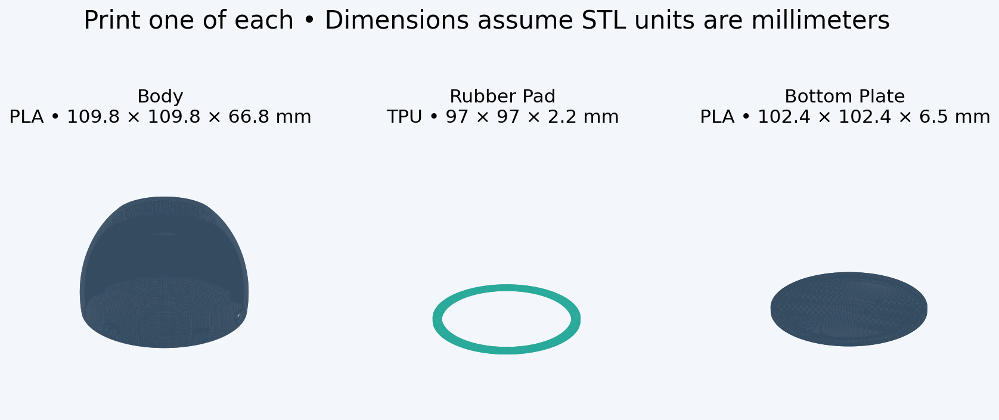
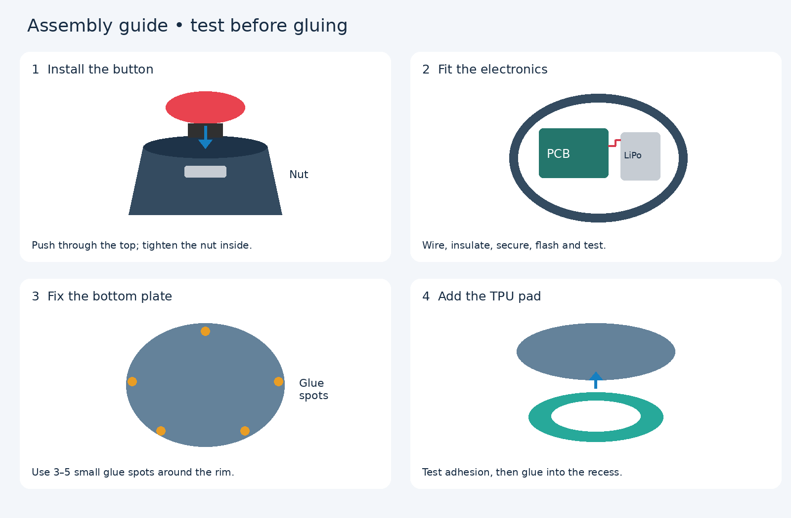

# 3D Print Case — printing and assembly

A three-piece enclosure for BLEBuzzer. All STL files are in this GitHub project folder, **3D Print Case**. The button is purchased separately.

## Files and materials

| File | Material | Approximate outside dimensions | Quantity |
| --- | --- | --- | --- |
| [Body.stl](Body.stl) | Common PLA | 109.8 × 109.8 × 66.8 mm | 1 |
| [Bottom Plate.stl](Bottom%20Plate.stl) | Common PLA | 102.4 × 102.4 × 6.5 mm | 1 |
| [Rubber Pad.stl](Rubber%20Pad.stl) | TPU | 97 × 97 × 2.2 mm | 1 |

## Assembly overview

## 1. Insert and secure the button

Insert the button from **above** through the Body's top opening. Fit its supplied retaining nut from **inside** and tighten until the button is held firmly. Hold the button housing so the wires do not twist. Avoid overtightening against the PLA. No glue is needed for the button.

Use the normally-open switch contacts, not any separate lamp contacts. Follow the [main wiring guide](../README.md#wiring-the-button-and-battery).

## 2. Wire, fit, and test the electronics

With USB and battery disconnected, wire the button to **006 and GND**, and the suitable 1S LiPo to **B+ and B−**. An **100–200 mAh** cell is the intended capacity range, subject to fit and charger compatibility. Check the cell's allowable charge current, especially at 100 mAh.

Insulate solder joints and secure the PCB and battery so they cannot rattle.

Flash the firmware and test the button over USB and BLE **before closing the case**. Check that the plate seats without trapping wires or compressing the battery.

## 3. Fix the Bottom Plate

Once the electronics work and the fit is correct, unplug USB and disconnect the battery if accessible. Seat the Bottom Plate in the Body and secure it with **3–5 small spots of super glue** around the mating rim. Use only enough adhesive to hold it.

## 4. Glue the TPU Rubber Pad into the underside

Fit the TPU ring into the matching underside recess. Its flat contact surface should face the table. Glue the pad with a small amount of super glue..

[Back to the project README](../README.md)
