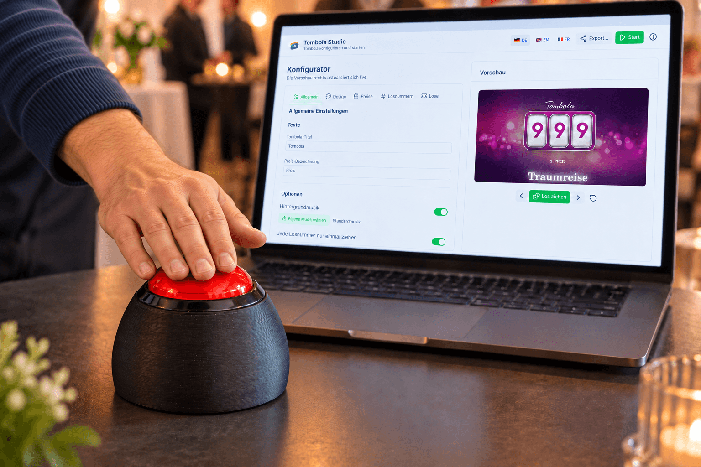
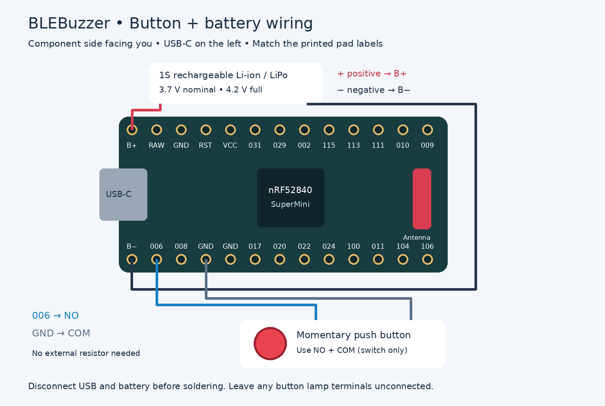

# BLE Quiz Buzzer — Bluetooth & USB Quiz Button

A big push button that works like a tiny keyboard. Press it to send **A followed by Space** to a computer, tablet, or phone over Bluetooth Low Energy (BLE), or to a computer over USB. It consumes only around 10 µA in deep sleep.

No custom receiver or companion app is included. Your quiz, game, or presentation software must respond to those keys. The button itself does **not** produce sound: any sound must come from the receiving application.



Product illustration based on the finished prototype.

## Start here

1. Get the board, button, and USB data cable listed below.
2. Connect the button as shown in the wiring guide.
3. Obtain or build this project's `firmware.uf2`. See Releases on the right side for direct download links.
4. Copy it onto the board's bootloader drive.
5. Test over USB, then pair over Bluetooth.
6. Add a suitable battery if you want wireless operation.

## What it does

| Feature | Current behavior |
| --- | --- |
| Bluetooth name | `BLE Quiz Buzzer` |
| Device type | Standard HID keyboard Device |
| Button action | Sends the A key, releases it, then sends and releases Space |
| Connection priority | Device acts as a USB keyboard when the computer has recognized the USB device; otherwise connected BLE |
| Repeat protection | Approximately one second between accepted presses |
| Holding the button | No intentional keyboard auto-repeat; release before pressing again |
| Idle sleep | Enters system-off sleep after about 10 minutes without button activity, including during USB use |
| Wake | Press the button; the board restarts and reconnects |
| Battery reporting | BLE battery service updated about every two seconds; approximate percentage |

The key is the HID **A key**, not a forced uppercase character. In a text editor it normally appears as lowercase `a` followed by a space.

The firmware implements one button. It does not include multi-player first-press lockout, player IDs, scorekeeping, or a quiz application. Multiple units currently send the same keys and advertise the same name. For having multiple unique units, you have to change the firmware's code.

## Parts and tools

| Item | What to choose |
| --- | --- |
| Microcontroller | nRF52840 SuperMini / Pro Micro-style board, compatible with the supplied nice!nano board definition |
| Board link | [Board used for this project](https://de.aliexpress.com/item/1005009750451202.html) — most of the boards come with a factory-installed UF2 bootloader |
| Button | [Button selected for this project](https://de.aliexpress.com/item/1005002900624434.html); use its momentary, normally-open switch contacts |
| Cable | USB-C cable that supports **data**, not just charging |
| Battery, optional | One suitable protected 1S LiPo, **100-200 mAh**, 3.7 V nominal / 4.2 V full; verify charger compatibility |
| Wiring | Thin insulated wire, soldering iron, solder, and heat-shrink tubing |
| Test equipment | Multimeter with continuity mode, particularly if the switch terminals are unmarked |
| Enclosure | Print the supplied case; see [3D Print Case](3D%20Print%20Case/README.md) |

## Where to buy

Buy the [nRF52840 board here](https://de.aliexpress.com/item/1005009750451202.html) and the [large momentary button here](https://de.aliexpress.com/item/1005002900624434.html). These are components we tested.

A suitable **100–200 mAh 1S LiPo**, USB-C data cable, wire, and adhesive can be sourced from an electronics or model-making supplier. Check battery dimensions, polarity, protection, and permitted charge current before ordering.

The case is supplied as printable STL files in this repository's **[3D Print Case](3D%20Print%20Case/README.md)** folder: print the Body and Bottom Plate in PLA and the Rubber Pad in TPU for better grip on the table. That folder also contains a separate illustrated printing and assembly guide.

## Wiring the button and battery



The drawing shows the **component side**: the large processor and red antenna are visible, and USB-C points left.

| Connect this | To this board pad | Purpose |
| --- | --- | --- |
| Button COM/common terminal | `GND` | Ground reference |
| Button NO/normally-open terminal | `006` | Button input P0.06, defined as `PIN_006` |
| Battery positive (+) | `B+` | Battery supply |
| Battery negative (−) | `B−` | Battery return |

For a simple two-terminal momentary switch, either switch terminal can go to `006`; the other goes to `GND`. The switch has no polarity. If it has COM, NO, and NC terminals, use **COM and NO**, leaving NC unused. If terminal names are absent, check continuity: the chosen pair must be disconnected at rest and connected only while pressed.

**Do not connect the button to battery positive, RAW, or VCC!**

The code uses an internal pull-up resistor: the input sits high at rest and goes low when the button connects it to ground. No external pull-up resistor is required.

If the button includes a lamp, its lamp terminals are separate from its switch terminals. Leave them disconnected for this build. The firmware controls the board's status LED, not a button lamp.

### Assembly steps

1. Unplug USB and disconnect the battery before soldering.
2. Identify `006`, `GND`, `B+`, and `B−` by their printed labels.
3. Solder the two switch wires to `006` and `GND`.
4. Inspect for solder bridges and exposed wires. Test over USB before adding the battery.
5. With power disconnected again, wire battery + to `B+` and battery − to `B−`.
6. Insulate joints and secure the board and battery so pressing the button cannot pull on their wires.

### Battery and charging

Use a **single rechargeable cell** of the correct chemistry. Do not use a 2S pack, 9 V battery, non-rechargeable coin cell, or reversed polarity. Do not attach the cell to `VCC` or `RAW`!

This board family includes USB charging circuitry, but verify your exact board's charge current and the battery manufacturer's allowed charging current before charging. Cell capacity alone does not establish charger compatibility. A protected cell does not make an unsuitable charger safe. Stop using a damaged or swollen battery.

The code drives P0.13 low to disable the external VCC supply and reduce power use. Do not rely on VCC to power a button lamp or accessory in this build.

## Install the firmware using UF2

The specified board ships with UF2 bootloader **0.6.0**, as recorded from the tested board. **You do not need an SWD programmer or to install the bootloader for normal setup.** 

### 1. Get `firmware.uf2`

Download the `firmware.uf2` from the Releases section on the right side.

### 2. Enter bootloader mode

1. Connect USB-C to the computer with a data cable.
2. Reset twice quickly, within roughly half a second.
3. If your board has no reset button, briefly connect **RST to GND**, release, then repeat quickly. A temporary momentary switch between these pads makes this easier. Touch only those pads.
4. A removable drive should appear in Finder on macOS or File Explorer on Windows. On the tested board it is named **NICENANO**.

### 3. Copy the firmware

Drag **`firmware.uf2`** onto the bootloader drive. Wait for the copy to finish. The board normally restarts and the drive disappears. That is expected.

You can repeat this procedure to update the application later.

## Optional: upgrade the UF2 bootloader

The factory bootloader already supports UF2 flashing. Updating it is optional, for troubleshooting or when you want the tested newer version. Updating the **bootloader** and installing the **BLE Quiz Buzzer application** are separate operations.

### Tested upgrade to 0.11.0

The project owner successfully tested this exact updater on the board:

**[Download update-nice_nano_bootloader-0.11.0_nosd.uf2](https://github.com/adafruit/Adafruit_nRF52_Bootloader/releases/download/0.11.0/update-nice_nano_bootloader-0.11.0_nosd.uf2)**

1. Keep this project's `firmware.uf2` available to reinstall after the upgrade.
2. Connect the board directly to the computer using a reliable USB data cable.
3. Double-reset the board (RST to GND twice quickly) to open **NICENANO**.
4. Check `INFO_UF2.TXT`: this procedure is for the recorded **nice!nano / nRF52840-nicenano** board. Do not use an updater for another board model.
5. Copy **`update-nice_nano_bootloader-0.11.0_nosd.uf2`** onto **NICENANO**. This is the updater, not the quiz-button application. Wait for it to finish and restart; leave USB connected during the operation.
6. Enter UF2 mode again with a double reset. Open `INFO_UF2.TXT` and verify bootloader **0.11.0**, the expected board identity, and **S140 6.1.1**.
7. Copy the project's **`firmware.uf2`** onto **NICENANO** again, then test USB input and Bluetooth.

## First test over USB

1. Connect the flashed board to the computer.
2. Open a blank text document and click into it.
3. Wait a couple of seconds after startup.
4. Press and release the quiz button. On a normal English keyboard layout you should see `a` followed by a space.
5. Wait more than one second before pressing again.

USB has priority when mounted, even if BLE is connected too. The keys go to whichever app currently has keyboard focus. In your quiz application, configure the A key and/or Space action as appropriate; remember that the firmware sends **both**.

## Pair and use over Bluetooth

1. Power the board from the correctly connected battery. Disconnect computer USB when testing wireless key delivery.
2. Open Bluetooth settings on the host and scan/add a device.
3. Select **Buzzer Keyboard** and follow the host's prompts.
4. Open a blank text document, focus it, and test the button.

On Windows, use **Settings → Bluetooth & devices → Add device → Bluetooth**. On macOS, use **System Settings → Bluetooth** (System Preferences on older versions). On a phone or tablet, use its Bluetooth settings. The host must support BLE keyboards.

If the host demands that you type a pairing code on the button, this firmware cannot type arbitrary digits; record the exact prompt and host OS for troubleshooting. Do not assume a PIN such as 0000.

The firmware advertises again after disconnection; host-side reconnection can still take a moment. After ten minutes of inactivity, press to wake, allow reconnection, then release and press again for a reliable first input. Do not count on the wake press reaching the host.

## Status LED

| Board LED | Meaning in the current firmware |
| --- | --- |
| Slow blink, about half a second on/off | No BLE connection and USB not mounted; waiting for a host |
| Steady on | USB mounted, provided BLE is not also connected |
| Off between presses | BLE connected, or board asleep |
| Brief flash | An accepted button press; it does not prove a host received the keys |

The BLE-connected LED rule takes priority over the USB rule, while **USB still has priority for key delivery**. Bootloader LEDs and charging LEDs may behave differently.

## Battery percentage and sleep

A suitable **100–200 mAh LiPo** can power the wireless button. The software enters an ultra-low-power system-off state after around ten minutes of inactivity and wakes on a button press. This gives very long standby potential, but the battery does not literally last forever: awake/connected time, board revision, cell self-discharge, and actual sleep current determine runtime. No measured runtime for an 100–200 mAh cell is supplied.

**Small-cell charging matters:** an 100 mAh cell may not tolerate the board's factory charge current. Choose a cell whose specified charging limit is compatible, or use a properly configured charger; do not assume every LiPo in this capacity range is interchangeable.


Battery percentage is a rough voltage estimate: the code maps 3.3 V to 0%, 3.7 V to 100%, and everything above 3.7 V to 100%. It is not a fuel gauge. It may remain at 100% for a long time and can be misleading while USB is attached because VDDH can reflect USB power. Whether the host displays the BLE battery service depends on the host.

## Build the firmware (optional for users with a prebuilt UF2)

### With Visual Studio Code and PlatformIO

1. Install [Visual Studio Code](https://code.visualstudio.com/).
2. In its Extensions view, install **PlatformIO IDE**. Let setup complete and reload if prompted.
3. Download this repository with **Code → Download ZIP** and extract it, or clone it with Git.
4. Open the extracted **BLEBuzzer folder containing `platformio.ini`** in VS Code. Do not open only `src` or the outer downloads folder.
5. Open PlatformIO's Project Tasks, then **mini_nrf52840 → General → Build**. The first build needs internet access to fetch the toolchain and framework.
6. Check the build output for success and UF2 conversion output.
7. Find the newly generated **`firmware.uf2` in the project root** and flash it as described above.

The custom `nicenano` board definition and variant are included. Bluefruit and TinyUSB come from the selected Adafruit Arduino framework; there is no separate `lib_deps` list in this project.

### From the PlatformIO terminal

Open PlatformIO's terminal in VS Code, change into the folder containing `platformio.ini`, and run:

```sh
pio run -e mini_nrf52840
```

The build produces `.pio/build/mini_nrf52840/firmware.hex`; the post-build script converts it to root-level `firmware.uf2`. Use **Build**, then copy UF2; the PlatformIO Upload task uses a different upload route.

### If automatic UF2 conversion fails

The included hook calls a command named `python` and does not enforce the converter's return code. Thus “Done” alone is not proof of successful conversion. Check that the UF2 exists and its modification time is from your latest build; an old UF2 may still be present.

After the HEX has built successfully, run this from the project root using your Python 3 command:

```sh
python3 tools/uf2conv.py .pio/build/mini_nrf52840/firmware.hex -c -f 0xADA52840 -o firmware.uf2
```

On Windows, if `python3` is unavailable but the Python launcher is installed:

```powershell
py -3 tools/uf2conv.py .pio/build/mini_nrf52840/firmware.hex -c -f 0xADA52840 -o firmware.uf2
```

The Nordic platform version is currently unpinned. Future dependency changes can affect builds; no fresh firmware build or physical-board test was performed when preparing this documentation.

## Customize it

Edit `src/main.cpp`, save, rebuild, then copy the new UF2 to the board.

| Setting | Where / default |
| --- | --- |
| Bluetooth and USB product name | `DEVICE_NAME`, currently `Buzzer Keyboard` |
| Manufacturer | `DEVICE_MANUFACTURER`, currently `TOLDO TECHNIK` |
| Firmware version string | `DEVICE_VERSION`, currently `1.1.0` |
| Button GPIO | `PIN_BUTTON`, currently `PIN_006` |
| Minimum press interval | `PRESS_COOLDOWN_MS`, currently `1000` milliseconds |
| Idle sleep timeout | `SLEEP_TIMEOUT_MS`, currently `10 * 60000` milliseconds |
| Keys sent | The two `sendKey(...)` calls in `loop()` |

For a Space-only button, replace the two calls with:

```cpp
sendKey(HID_KEY_SPACE);
```

Changing the GPIO requires moving the input wire too. Avoid pins reserved for the board LED, external power control, USB, or other board functions. After changing the Bluetooth identity, you may need to forget the old device on the host and pair again.


## Repository contents

| Path | Purpose |
| --- | --- |
| `src/main.cpp` | Button handling, USB/BLE keyboard, LED, battery reporting, and sleep |
| `platformio.ini` | Build environment configuration |
| `boards/nicenano.json` | Custom board definition and SoftDevice selection |
| `boards/nicenano/variant.h` | GPIO names and peripheral pin definitions |
| `boards/nicenano/variant.cpp` | Arduino-to-hardware pin mapping |
| `tools/convert_to_uf2.py` | Post-build UF2 conversion hook |
| `tools/uf2conv.py` | Bundled UF2 converter |
| `tools/uf2families.json` | UF2 family identifiers |
| `docs/` | Wiring graphics and supplied hardware photographs |
| `3D Print Case/` | Three STL files plus printing and illustrated assembly instructions |
